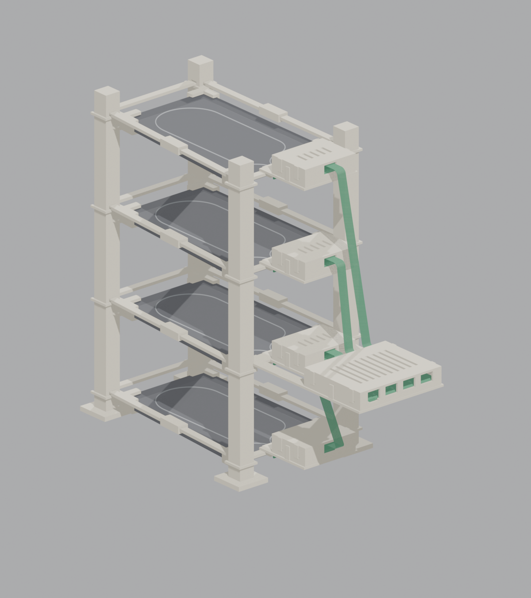

# Muon3 — modular classroom muon detector

Muon3 uses four reclaimed sPHENIX inner-HCal scintillator tiles and their Hamamatsu
S12572-33-015P sensors to detect coincident particle passages. Revision E is the
current design: four identical detector boards, one USB/Wi-Fi controller, hardware
pulse-width and coincidence acquisition, and a modular ABS frame for the Prusa
CORE One. Each station uses four tiles of one shape; generators support all twelve
inner-HCal shapes.

**Engineering prototype.** CAD validity, electrical rules, digital simulation and
physical measurements are different checks. Generated files are not proof of
measured efficiency, calibrated timing, electrical compliance or durable snap fits.
Use the recorded check results below and print the fit coupons before a full set.
The former 337 × 40 mm Rev D board and screw/rod assembly remain in the source for
comparison; they are not the current manufacturing workflow.



## What changed

| Area | Revision E |
|---|---|
| Detector electronics | Four copies of one 60 × 45 mm, 1.6 mm PCB, close to each sensor |
| Controller | 100 × 80 mm, 1.6 mm PCB with ESP32-S3 and iCE40UP5K |
| Acquisition | Shared-clock leading/trailing-edge information, ToT, fixed-window coincidence, event FIFO and explicit loss counters |
| Communication | USB and Wi-Fi; optional UDP telemetry in the prototype firmware |
| Local settings | One MCP4728 and local regulator/bias circuit per detector; individually addressed through an I2C multiplexer |
| Mechanical structure | Printed tower segments, keyed sockets, load shoulders, tile cradles, rails, pod shelves and releasable retainers |
| Enclosures | Four detector pods and one controller pod with PCB seats, connector access and snap lids |
| Printing | CORE One 250 × 220 × 270 mm; conservative 230 × 200 mm part/packing area |
| Complete CAD | Tiles, fiber loops, coating/wrap, SiPM daughterboards, populated main PCBs, sensor coax and forty harness conductors |

The tiles, fibers, SiPMs, populated electronics, antenna and electrical cables are
supplied parts. The new structural frame and enclosure parts are printed. A printed
part is not substituted for optical scintillator, electrical wire or connectors.

## What it measures

A muon crossing a tile produces scintillation light. A wavelength-shifting fiber
carries some light to the SiPM. The OPA356 converts the SiPM current to a voltage;
a programmable threshold and LMV7219 produce a digital pulse. The FPGA measures
the pulse duration and groups leading edges from different tiles into coincidence
windows. The ESP32 moves data to the classroom computer or network.

Time over threshold is a **calibrated pulse-size proxy**, not a direct measurement
of muon energy or momentum. Its response depends on threshold, baseline, gain,
fiber position, amplifier recovery and pileup. The four large tiles each have one
combined optical readout, so this instrument does not measure a precise hit
position. Track-based muon tomography requires position-sensitive planes and more
readout channels. The controller exposes four spare FPGA signals and ground for a
future extension; the current gateware does not acquire them.

The acquisition clock target is 100 MHz (10 ns bins). The final place-and-route
report, not that target, decides whether a bitstream is valid at that frequency.
Input high and low intervals must each meet the documented minimum width.
Near-threshold pulses may be too short, even when larger pulses are captured.
See [the acquisition specification](hw/gateware/README.md) for exact timing,
coincidence semantics, FIFO behavior, SPI framing and counter interpretation.

## Electronics and wiring

The canonical circuit and physical interface are generated from
[`hw/src/modular.ts`](hw/src/modular.ts). Parts are placed and routed by
[`hw/src/build_modular.ts`](hw/src/build_modular.ts). Schematics use typed IC pins,
standard passive/amplifier graphics and functional blocks. The selected LCSC part
identity is kept separately from any shared footprint geometry. Passive values are
resolved exactly; approximate substitutions must be explicit design decisions.

Both PCBs use four copper layers and components on the top side. Snap PCB seats
replace mounting screws; preserve the specified edge keepouts when modifying
placement. One station needs **four detector boards and one controller board**.

Each detector uses the existing short sensor coax with its bias-bearing shield
inside the detector pod. This connection must remain enclosed and must not be
confused with a grounded signal cable. The inter-board harness carries only the
listed low-voltage supplies/signals; SiPM bias is generated locally. The revised
boost switch is the 240 V BSS131 with a TC4427 gate driver, replacing the previous
marginal switch/drive combination. The 2.2 ohm current-limit resistor targets
approximately 136 mA peak inductor current. The ideal discontinuous-mode energy
budget is about 46 mW at the assumed 33 kHz; losses reduce this, and the bias
feedback, monitor divider and bleed already consume about 16 mW near 80 V.
Real switching peaks, delivered power, ripple, startup, discharge and noise still
require bench checks. See the [BSS131 ratings](https://www.infineon.com/assets/row/public/documents/24/49/infineon-bss131-ds-en.pdf)
for the distinction between pulsed and continuous drain current.

| Harness pin | Detector | Controller channel n |
|---|---|---|
| 1 | 5 V | 5 V |
| 2 | Ground | Ground |
| 3 | HIT | HITn |
| 4 | Ground | Ground |
| 5 | SDA | SDAn |
| 6 | SCL | SCLn |
| 7 | HV enable | Shared HV enable |
| 8 | HV monitor | ADC input n |
| 9 | Calibration injection | Shared injection |
| 10 | Ground | Ground |

Use keyed 2 × 5, 2.54 mm headers and correctly polarized mating IDC cable
assemblies. Check continuity pin-for-pin before applying power. CAD cable paths are
routing envelopes: provide actual connector bodies, bend radii and service slack
when making the harness. Verify digital pulse integrity with the actual cables.

The controller's TCA9546 selects one I2C branch at a time. Each identical detector
has a DAC at 0x60 and BME280 at 0x76. The sensor is on the detector board; its reading
is not automatically the SiPM junction temperature or undisturbed room temperature.
Bias compensation needs a measured thermal relationship and per-sensor calibration.

Use a USB-C supply/powered hub advertising at least 1.5 A for the full station.
The controller routes CC voltage to ADC inputs. Automatic calibrated source
qualification remains a bring-up requirement; optional Wi-Fi requires an explicit
verified-power configuration. Universal operation from an unconfigured USB 2.0 port
is not established. Verify the final input protection, power budget and sequencing
on the assembled prototype. FPGA core and PLL supplies are 1.2 V; I/O is 3.3 V.

## Complete assemblies and printing

The source is [`hw/case/modular_v2.py`](hw/case/modular_v2.py), with shared tile
geometry in [`hw/case/tile_geometry.py`](hw/case/tile_geometry.py). Generated
per-shape assemblies are under `hw/out/assembly/modular_v2/tileNN/`:

- `station.FCStd`: editable, named FreeCAD assembly.
- `station.step`: interchange assembly including supplied components.
- `manifest.json`: part inventory, cable routes, dimensions and geometry checks.
- `print/`: STEP/STL files in print orientation for printed parts only.
- Packed 3MF plates and packing reports from `pack_modular.py`.

The station uses 100 mm tile center spacing. Shape-specific cradles locate wrapped
tile corners without drilling the scintillator. Segmented rails accommodate wide
shapes, including the roughly 403 mm tile 12, within the printer bed. Sockets and
shoulders carry compression/shear; separate retainers prevent withdrawal. Detector
pods and the controller pod sit on printed shelves attached to the rear structure.

Start with the socket and snap coupons. The nominal square tenon is 12 × 12 × 8 mm;
fit gauges provide 0.15, 0.25 and 0.35 mm clearance **per side**. The initial nominal
socket uses 0.25 mm. Print orientation and actual ABS shrinkage matter more than a
nominal clearance on a drawing. Use the same filament, nozzle and settings for the
coupons and final parts. Check insertion, release, repeated cycling and retention
before selecting the clearance. Then test one populated detector pod and one
loaded frame joint before printing the rest.

The supplied CORE One projects are a 0.4 mm nozzle / ABS starting point. They are
not a tuned profile for an unspecified filament. Inspect the plate arrangement,
brim spacing, bridges and supports in PrusaSlicer. Slice for the actual installed
printer and material; this repository does not send a print or start a machine.
Printed latch durability, creep, drop resistance and final tile retention have not
been physically tested.

A complete assembly includes the preserved fiber-loop model, reflector, aluminum,
cling-film and black wrapping layers. The original upstream tile CAD does not
contain these details; the loops/couplers are engineering reconstructions. Match
real GSU tiles and fiber routing before altering the supplied optics. Rendering
transparency is illustrative; it does not imply a translucent light-tight wrap.

## Build and check

Tools used here: Bun, KiCad CLI, FreeCAD, PrusaSlicer, Node 20+, Python with NumPy
and Matplotlib, ngspice, Yosys, nextpnr-ice40 and IceStorm. ESP-IDF is needed to
compile/flash controller firmware. Do not confuse a successful source build with
hardware validation.

From the repository root:

```sh
# Circuit, placement, routing, schematic and board metadata
cd hw
bun run build:modular
cd ..

# Independent board checks and source/schematic/PCB connectivity comparison
python3 hw/tools/check_modular.py
python3 tools/verify_modular.py

# Digital behavior and actual FPGA implementation/timing
sh hw/gateware/tests/run.sh
sh hw/gateware/build.sh

# The populated board STEP exports must exist before CAD generation
bash hw/case/build_modular.sh 1 2 3 4 5 6 7 8 9 10 11 12

# Analog behavior estimate for the selected front end
.venv/bin/python hw/sim/characterize_tot.py
.venv/bin/python sim/python/sipm_to_tot.py hw/out/modular/analog/tot.csv --npe 36
```

Set `FREECAD_CMD` to the installed command-line executable on non-macOS hosts.
`HW_OFFLINE=1` reuses cached part data for repeat builds; fetch missing parts first.
Board output directories are `hw/out/modular/detector/` and
`hw/out/modular/controller/`. Inspect the native schematics and PCB files there.
The electronic release checker must be run after the final generation; missing or
old reports must not be treated as current approval to fabricate.

ClassCAD is installed as an MCP and signed in on this machine. A pinned project
client makes its use reproducible:

```sh
npm ci --prefix tools/classcad
node tools/classcad/build.mjs
node tools/classcad/build.mjs hw/out/assembly/modular_v2/tile01/station.step
```

The first command after installation may download the ClassCAD engine. The build
creates native ClassCAD socket gauges and verifies their solid volumes against
independent arithmetic. The assembly command imports the complete STEP, measures
positive solid volume and renders it. Outputs are in `hw/out/classcad/`.
ClassCAD login credentials remain outside the project and are never exported.

## Validation and remaining physical work

The reproducible checks cover:

1. Circuit pin-number mappings, exact selected part identities and low-voltage
   harness consistency.
2. KiCad ERC/DRC, plus independent schematic XML versus source and PCB-pad
   connectivity comparison.
3. FPGA tests for simultaneous channels, pulse widths, coincidence boundaries,
   reset, FIFO loss/recovery, SPI abort/retry and randomized event streams.
4. FPGA synthesis, placement and routing against the requested clock.
5. Valid CAD solids, printable mesh integrity, printer-envelope/plate checks and
   modeled assembly interference.
6. ClassCAD volume/bounds checks and visual inspection of generated assemblies.

The analog sweep is deliberately labeled **behavioral simulation**. At its current
assumed 7 pF short-cable load, 33 kohm / 2.7 pF feedback and 35 mV nominal threshold,
the 36-photoelectron test pulse gives approximately 312 ns ToT. This is not measured
calibration. The former built-in OPA858 fit has been removed; `sipm_to_tot.py` now
requires an explicit table and refuses extrapolation beyond it.

Before a classroom deployment, measure power/current limiting, all bias settings
and discharge, dark-rate/threshold curves, injected pulse recovery, cable ringing,
crosstalk, temperature behavior and acquisition loss under active Wi-Fi. Measure
single-photoelectron gain and the coincidence-efficiency plateau on actual tiles.
Validate the printed enclosure and frame with the intended load. The prototype
firmware leaves bias disabled until a deliberate calibrated operating procedure is
implemented; loading a bitstream alone does not make a calibrated station.

The older Geant4 tile-light simulations, thermal/EMI estimates, production cost
estimates and Rev D test instructions are reference evidence. They do not validate
new board layouts, new cables, the local bias circuits or the new enclosures. No
legacy efficiency, interference or landed-cost figure is promoted to a Rev E result.

## Repository map

| Location | Role |
|---|---|
| `hw/src/modular.ts` | Current detector/controller circuits and interface |
| `hw/src/build_modular.ts` | Current PCB generation |
| `hw/src/modular_schematic.ts` | Native typed KiCad schematic generation |
| `hw/gateware/` | Acquisition RTL, SPI protocol, tests and timing build |
| `hw/firmware/` | ESP32 prototype and shared frame decoder |
| `hw/case/modular_v2.py` | Current modular structure and complete assembly |
| `hw/case/pack_modular.py` | Print-oriented plates and CORE One projects |
| `tools/classcad/` | ClassCAD model/export/verification client |
| `tools/verify_modular.py` | Independent source/schematic/PCB parity check |
| `hw/sim/characterize_tot.py` | Current AFE behavioral sweep |
| `cad/sphenix_hcal/` | All twelve tile outlines, original GDML, fiber model and tile STEP files |
| `sim/geant4/` | Existing scintillation/light-transport simulations |
| `reference_documentation/` | Historical evidence and earlier requirements; superseded where this baseline differs |

The current baseline is indoor, USB/Wi-Fi, reclaimed Hamamatsu-equipped tiles and
printed ABS mechanics. Cellular, TEC cooling, new MicroFC sensors and inter-station
GNSS timing from older requirements are not part of this revision.
